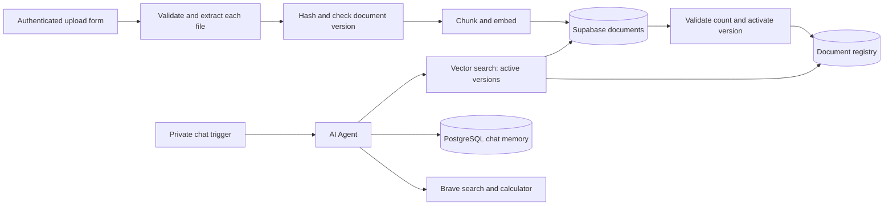

# RAG AI Assistant

An n8n Cloud assistant that indexes uploaded documents in Supabase and answers questions with source references.

## What it does

- Accepts up to three PDF, TXT, or MD files per upload and processes each file separately.
- Splits extracted text into overlapping chunks and indexes 1536-dimensional `text-embedding-3-small` vectors.
- Uses a SHA-256 content hash to identify duplicate uploads. A changed file becomes active only after its new chunks are indexed and counted.
- Retrieves active document versions for the AI Agent and includes source filenames in grounded answers.
- Maintains conversation context with PostgreSQL Chat Memory. The Agent also has Brave search and calculator tools.

## Architecture



The n8n Supabase Vector Store writes chunks to `public.documents`. The `match_documents` function returns chunks from the active version in `public.document_registry`. The ingestion workflow calls `rag_private.activate_document` through a dedicated PostgreSQL login after insertion succeeds. Activation checks the staged chunk count and switches versions in one transaction.

## Stack

| Component | Use |
| --- | --- |
| n8n Cloud | Upload, ingestion, retrieval, chat, and tool orchestration |
| Supabase PostgreSQL and pgvector | Vector storage, similarity search, and document registry |
| OpenAI via n8n Gateway | `text-embedding-3-small` embeddings and the configured chat model |
| PostgreSQL Chat Memory | Conversation history keyed by session |
| Brave Search | Optional web search tool |
| Node.js | Offline workflow checks and retrieval metric script |

## Functional checks

The following behavior was observed in live n8n Cloud tests:

- Uploaded and indexed documents, then retrieved answers with source attribution.
- Continued a conversation in one chat session, including a user-provided test code.
- Handled a question whose answer was absent from the knowledge base.
- Uploaded two documents in one execution and answered across both with correct source citations.
- Detected an unchanged upload without creating another document version.
- Replaced a modified `project-alpha.txt` and answered with the new manager, Layla, citing that file.

These are functional observations. Retrieval Hit@k, MRR, latency distributions, security, scale, and PostgreSQL persistence across restarts have not been comprehensively measured. See the [test record and evaluation plan](docs/testing.md).

## Setup

The sanitized, credential-free workflow exports, [document ingestion](workflows/01-document-ingestion.review.json) and [conversational assistant](workflows/02-conversational-assistant.review.json), can be imported directly without the original exports. The root-level originals are preserved locally and excluded from Git because they contain n8n identifiers. They are needed only to regenerate the review copies with `npm run build:workflows`.

For a fresh deployment, apply [the schema](supabase/schema.sql) to a Supabase project, create a dedicated PostgreSQL login with `rag_workflow`, import the two review copies as inactive workflows, and attach credentials in n8n. The [setup guide](docs/setup.md) gives the exact order and notes the migration already applied to the existing project. Do not put credentials in workflow JSON.

Offline checks require Node.js 20 or newer and make no network requests:

```sh
npm test
```

The upload form and chat trigger are private in the exports. Keep authentication and execute access enabled before exposing them. The 5 MiB file limit runs after upload, so set a hosting-level limit; failed inserts can leave inactive chunks. See [setup](docs/setup.md) for access and cleanup.

For a short portfolio summary, see [project notes](docs/portfolio.md).
